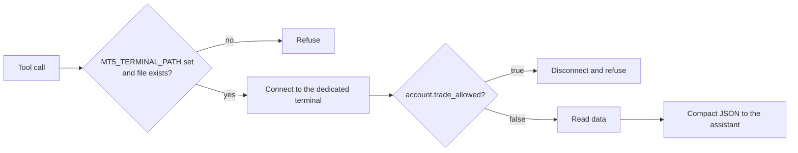

# mt5-readonly-mcp

[](https://github.com/HermanSetiawan77777/mt5-readonly-mcp/actions/workflows/ci.yml)


[](LICENSE)

A [Model Context Protocol](https://modelcontextprotocol.io) (MCP) server that lets an AI assistant such as Claude **read** a MetaTrader 5 account (positions, pending orders, trade history, prices and symbol specs) **and makes it unable to trade**.

Giving a language model access to a brokerage account is useful for journaling and analysis, but one misread prompt should never be able to open a position. This server is built so that read-only does not depend on the model behaving: it is enforced in code, checked on every call, and the server refuses to work if the check fails.

## How read-only is enforced

| Layer | What it does | Code | Test |
|---|---|---|---|
| 1. No trading code path | No tool places, modifies or closes orders. On import, `order_send` and `order_check` in the MetaTrader5 package are replaced with a function that always raises. | [`guard.py`](src/mt5_readonly_mcp/guard.py) | `test_trading_functions_are_replaced` |
| 2. Fail-closed account check | Before **every** tool call the logged-in account must report `trade_allowed = false`, which is the case for an investor-password login. Otherwise the call is refused and the terminal is disconnected. | [`guard.py`](src/mt5_readonly_mcp/guard.py) | `test_guard_runs_on_every_tool_call` |
| 3. Dedicated terminal | Connects only to the terminal in `MT5_TERMINAL_PATH`, a terminal used for nothing else. No path, no connection. | [`guard.py`](src/mt5_readonly_mcp/guard.py) | `test_missing_terminal_path_is_refused` |
| Confined exports | Export tools write CSV files only inside `MT5_EXPORT_DIR`. Absolute paths and `..` are refused, because tool arguments come from the model. | [`export.py`](src/mt5_readonly_mcp/export.py) | `test_exports_cannot_leave_the_export_folder` |
| No secrets | The server never receives a password. The dedicated terminal keeps the investor password saved when you logged in by hand. | | |

Every tool also carries MCP [tool annotations](https://modelcontextprotocol.io/specification/2025-06-18/server/tools) (`readOnlyHint`, `destructiveHint`), so clients can show which tools only read.



## Tools

| Tool | Returns |
|---|---|
| `account_info` | Balance, equity, margin, leverage, account type and the read-only status |
| `positions` | Open positions, optionally filtered by symbol |
| `pending_orders` | Active limit, stop and stop-limit orders with expiry |
| `deal_history` | Closed trades, one row per position: entry and exit merged, volume-weighted prices, initial SL/TP, exit reason (stop loss, take profit, manual, stop out), commission, swap and net result |
| `candles` | OHLC candles for any timeframe from M1 to MN1 |
| `symbol_info` | Contract size, volume limits, tick value, spread and swaps |
| `symbols_list` | Symbols offered by the broker, filtered by wildcard |
| `quotes` | Bid, ask, spread and daily change for up to 60 symbols in one call |
| `export_candles` | Candles for many symbols and timeframes written to CSV |
| `export_deals` | Closed-trade history written to CSV |
| `export_state` | Snapshot of account, positions and pending orders written to CSV |

Results are compact JSON (column names once, then rows) to keep the assistant's context small. For large datasets the export tools write files instead, so the assistant can analyse them with code rather than reading thousands of rows. Symbols are resolved for broker suffixes, so `XAUUSD` finds `XAUUSDm`. All times are the broker's server time.

## Quick start (Windows)

You need Windows, MetaTrader 5, [uv](https://docs.astral.sh/uv/) and an MCP client such as [Claude Desktop](https://claude.ai/download).

1. **Install a second MetaTrader 5 terminal** into its own folder, for example `C:\MT5-ReadOnly` (the installer's *Settings* button lets you choose the folder). Keep your trading terminal separate.
2. **Log that terminal in with the investor (read-only) password** and tick *Save password*. Most brokers provide one when the account is opened; you can also set one in MetaTrader 5 under *Tools → Options → Server → Change*.
3. **Get the code and run the check:**

   ```powershell
   git clone https://github.com/HermanSetiawan77777/mt5-readonly-mcp.git C:\Tools\mt5-readonly-mcp
   $env:MT5_TERMINAL_PATH = "C:\MT5-ReadOnly\terminal64.exe"
   uv --directory C:\Tools\mt5-readonly-mcp run mt5-readonly-mcp --check
   ```

   A correct setup prints `OK: connected, read-only mode verified` and `trade_allowed = False (must be False)`. If the terminal is logged in with the master password, the check fails and tells you why.

4. **Add the server to Claude Desktop** (*Settings → Developer → Edit Config*, file `%APPDATA%\Claude\claude_desktop_config.json`):

   ```json
   {
     "mcpServers": {
       "mt5-readonly": {
         "command": "uv",
         "args": ["--directory", "C:\\Tools\\mt5-readonly-mcp", "run", "mt5-readonly-mcp"],
         "env": {
           "MT5_TERMINAL_PATH": "C:\\MT5-ReadOnly\\terminal64.exe",
           "MT5_EXPORT_DIR": "C:\\Users\\you\\mt5-exports"
         }
       }
     }
   }
   ```

   If Claude Desktop cannot find `uv`, use the full path to `uv.exe` as `command`.

5. **Restart Claude Desktop** and ask, for example:
   - "Show my open positions and pending orders."
   - "Summarise my closed trades this month by symbol: win rate, average win and loss, net result."
   - "Export H1 and M15 candles for XAUUSD and BTCUSD for the last 5,000 bars."

## Configuration

| Variable | Required | Meaning |
|---|---|---|
| `MT5_TERMINAL_PATH` | yes | Full path to `terminal64.exe` of the dedicated read-only terminal |
| `MT5_EXPORT_DIR` | no | Folder for CSV exports. Default: `%USERPROFILE%\mt5-readonly-mcp\exports` |

## Development

The MetaTrader5 package exists only for Windows, so the tests replace it with an in-memory fake ([`tests/fake_metatrader5.py`](tests/fake_metatrader5.py)) and run on any OS:

```bash
uv run pytest
uv run ruff check .
```

CI runs the tests on Linux for Python 3.10, 3.12 and 3.13, plus a Windows job that installs the real MetaTrader5 package, imports the server and confirms that it fails closed without configuration.

```
src/mt5_readonly_mcp/
  guard.py      safety layers 1-3
  data.py       read helpers and the deal-to-trade grouping
  export.py     CSV writing confined to the export folder
  server.py     the MCP tools
  __main__.py   command line: run the server or --check
```

## Limitations

- Windows only, because the MetaTrader5 Python package is Windows only.
- MetaTrader 5 history does not keep SL/TP changes made after entry, so `deal_history` reports the initial SL/TP.
- Read-only protects the account, not the data: anything the tools return is sent to the AI client you connect. Use a client whose data policy you accept.
- The tests use a fake terminal. Each release is also checked by hand against a live terminal (`--check`, then every tool).

## Disclaimer

Not affiliated with or endorsed by MetaQuotes Ltd. MetaTrader is a trademark of MetaQuotes Ltd. This software reads data only and gives no financial advice.

## License

[MIT](LICENSE)
